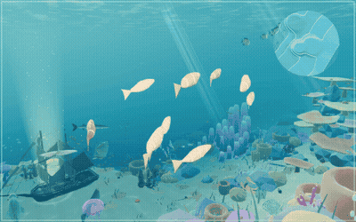
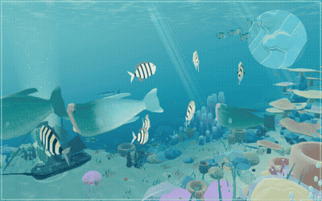
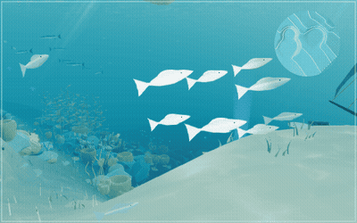
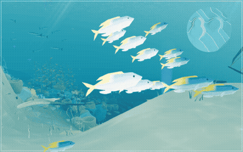
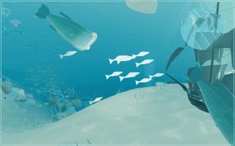
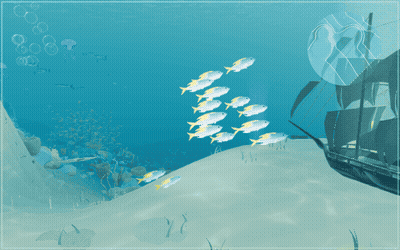

# Schooling fish: creature-set species, a stroke that follows each fish

The reef-wide schools of `ocean-refined/marine-life.js` (49 habitats, flocking with look-ahead navigation) now draw
four species from the creature set instead of the procedural boid fish: fusiliers, powder blue tangs, sergeant majors
and anthias. `ocean-refined/school-fish.js` draws them, one instanced mesh a species, with the swim stroke in the vertex
shader. No vertex-animation texture (see `TENFOLD_OPTIMIZATION.md`): the wave is computed from a per-fish phase,
amplitude and path curvature (one `vec3` instance attribute).

## Root causes of the "weird" motion, and the fix for each

Measured in node on the same scenario (three schools of the shallow and middle reef; a diver holds 14 m off, then swims
through at 2.5 m/s; 14 s), with the old file and the new one:

| Cause | Before | After |
|---|---|---|
| The body wave's phase came from the fish's **world position** (`dot(instanceMatrix[3].xyz, …)`), so travel changed the beat | beat 0.05–0.5 Hz (mean 0.3); correlation with speed **−0.75** | phase integrated per fish from its own speed: 1.15–2.9 Hz; correlation **+0.9 to +0.95** |
| …and could reverse it | wave ran tail-to-head in 18% (10 fps), 9% (30 Hz), 2.5% (60 Hz) of frames | 0% |
| Tail was a separate mesh wagging on its own fixed ~1 Hz clock, pinned at a fixed point while the body flexed | tail out of step with the body, root sliding over the stalk | tail is part of the body mesh and the same wave |
| Fins and eyes were a rigid third mesh | stayed put while the body bent | part of the body mesh |
| No bend or bank in a turn | rigid weathervane turns | body follows the arc of its path (curvature from yaw rate / speed, capped at 1/length); banks into the turn (≤ 0.42 rad) |
| Near schools took frame-sized steps | 30 vs 120 Hz: mean speed 1.05 vs 0.93 m/s, different courses | fixed step with an accumulator, drawn between the last two steps: courses identical at 30/60/120 Hz (3e-13 m apart after 6 s) |
| No burst | | a frightened fish turns up to 3.9 rad/s (was 1.3); beat rises with the sprint (1.8 → 2.6 Hz in the test) |
| Edge of the world | fish clamped and slid along the bounds | steered away 7 m before the edge; clamp kept as a fallback |

Not causes (checked): sideways slip of the simulated fish was already ~0 (p99 0.03–0.06 m/s, before and after); no
nudges by the diver clearance in the scenario; terrain clearance ≥ 1.7 m in a 40 s run. In the page, a raycast up from
every drawn fish at six spots found the old schools inside coral batches and the soft-coral spire; the new ones only pass
through the kelp grove's fronds.

## Species and habitat

Roles as before (open-water schools, grazers, residents); the depth of the seabed picks the species:
fusiliers everywhere in the open roles, powder blue tangs grazing above −32 m (fusiliers deeper), sergeant majors as
residents above −22 m, anthias down the slope. 478 fish (economy 231), against 490 (245). About a metre long, as before.

## Cost (`tools/perf-probe.mjs`, median of 3; `tools/perf-ab.mjs`, median of 9 rounds)

SwiftShader on four shared cores: bytes, calls, triangles, heap and the A/B are the numbers to trust.

| | Phone before | Phone after | Desktop before | Desktop after |
|---|---:|---:|---:|---:|
| Wire bytes to ready | 688 KB | 690 KB | 688 KB | 690 KB |
| Wire bytes until settled | 11.14 MB | 11.14 MB | 14.33 MB | 14.33 MB |
| Requests until settled | 148 | 149 | 148 | 149 |
| Dive draw calls / triangles | 105 / 212k | 105 / 210k | 162 / 552k | 162 / 543k |
| Programs | 68 | 64 | 69 | 65 |
| Textures (dive) | 46 | 53 | 53 | 58 |
| Heap after ready / after dive | 8.7 / 24.7 MB | 8.4 / 24.7 MB | 14.3 / 26.5 MB | 12.6 / 26.5 MB |
| World update per 1/30 s (A/B) | 1.20 ms | 1.00 ms | 2.20 ms | 1.90 ms |
| Frame-loop ms per drawn frame (noisy) | 32.2 | 34.1 | 14.3 | 12.2 |

- Draw calls for the schools: 4 meshes (one a species) instead of 5 (three bodies, tails, fins and eyes). Triangles per
  fish: 148 (economy 80) instead of about 200.
- The schools update in node at 0.46 ms vs 0.44 ms per frame (standard) and 0.32 vs 0.25 ms (economy): navigation
  dominates both; the new draw pass is cheaper.
- Loading is off the first dive's path: the meshes exist from the start (empty shape, one-texel skin, so the world
  compiles their shared program with everything else) and `world.js` asks for the shapes and skins with the optional
  models, after the landmarks (in economy, once a dive is asked for). The skins are the PNGs inside the species' GLBs,
  the same files the creature set fetches: each was downloaded once in every run (no extra bytes). Main-thread work
  35 ms in all, longest slice 17 ms; the PNGs decode off the main thread. If a file cannot be had, the skin is painted
  in code at 256×128 instead.
- GPU memory: 4 skins of 512×256 with mipmaps, about 2.8 MB (no animation textures).

## Frames

At the shallow reef (sergeant majors) and around the wreck (fusiliers), 1/30 s steps, 640×400, the page's HUD hidden.
`*-approach` has the diver swim at the school at 3 m/s from 9 m. Made with `node tools/capture-schools.mjs`.

| | Before | After |
|---|---|---|
| Shallow reef |  |  |
| Wreck |  |  |
| Wreck, diver approaching |  |  |

Strips (every seventh frame): `*-strip.jpg`; stills: `*.jpg`.
