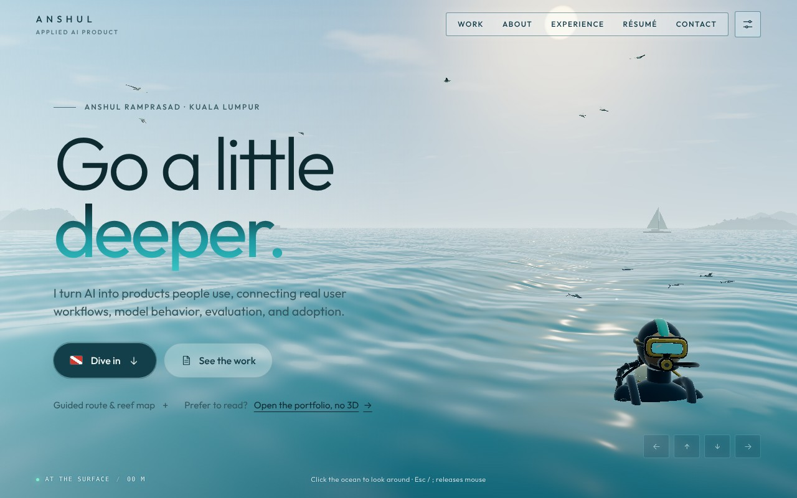
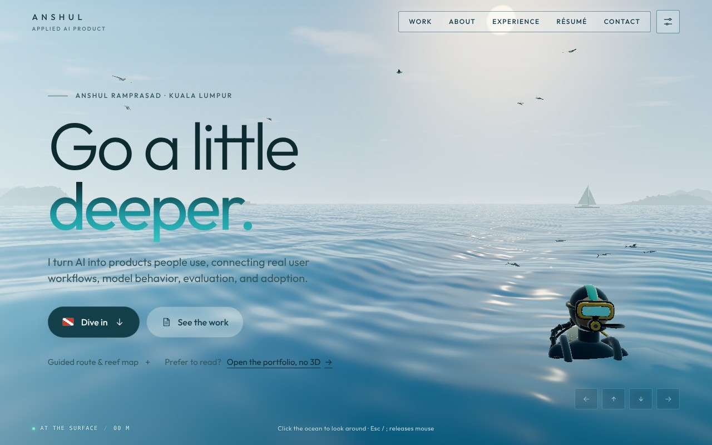
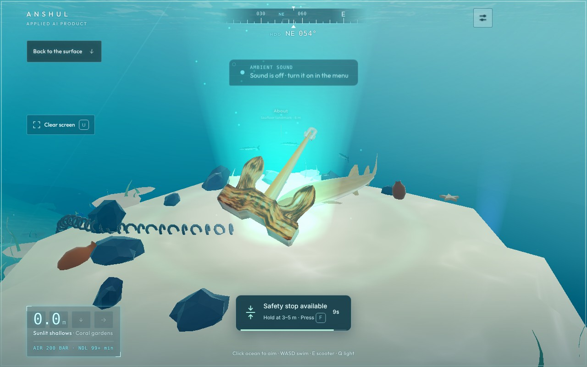
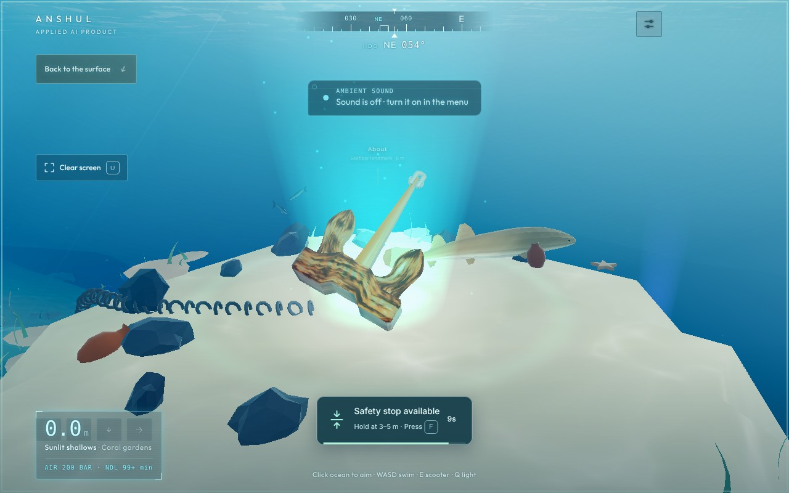
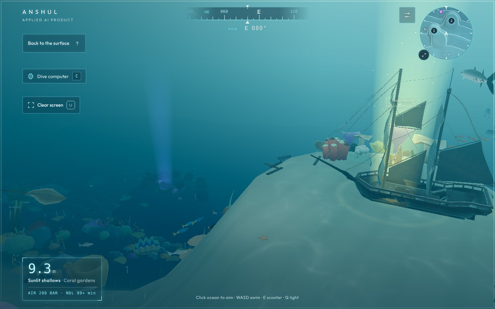
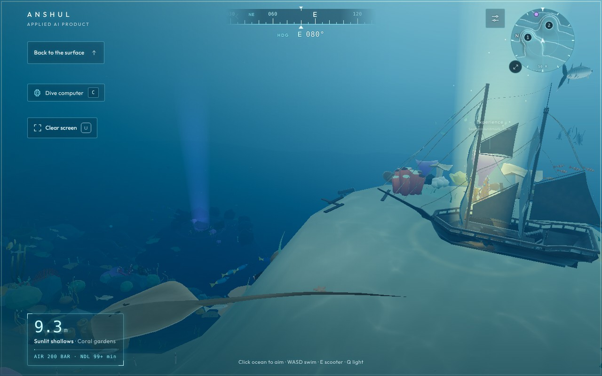
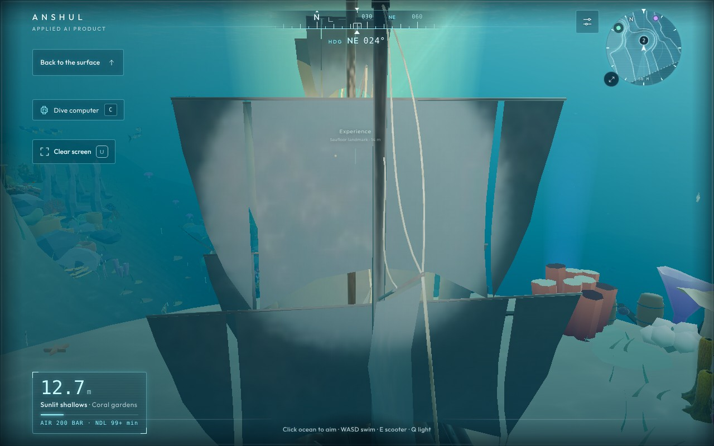
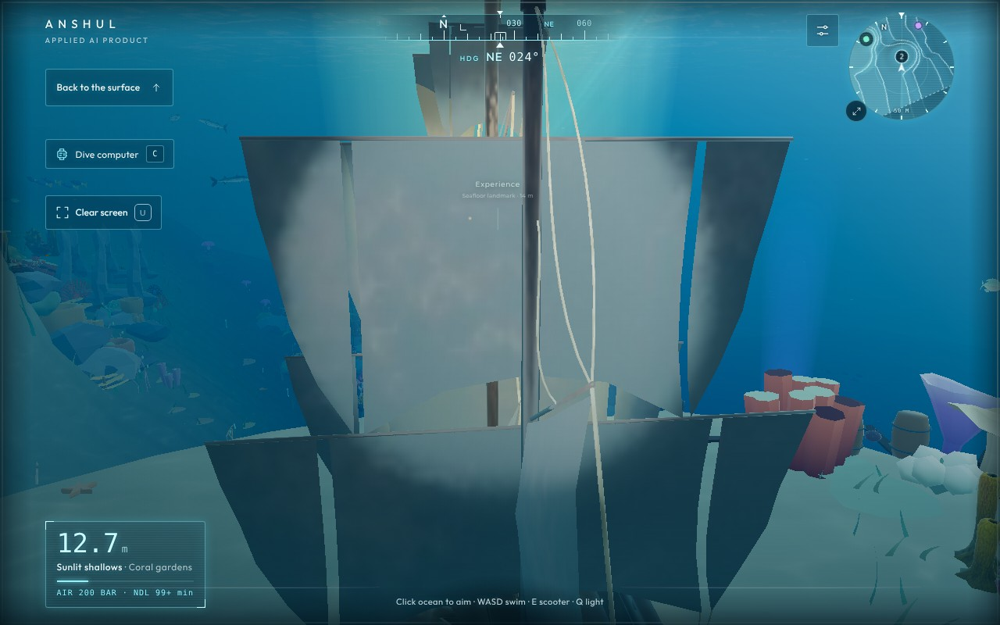
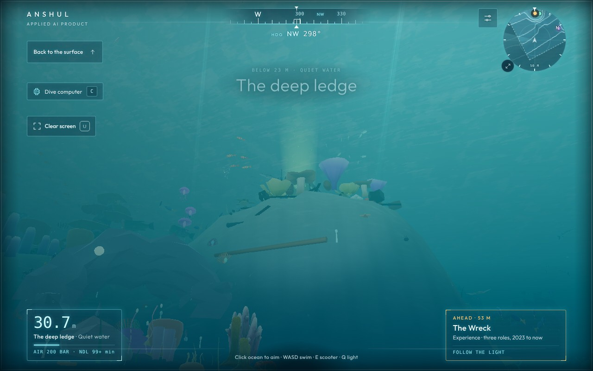
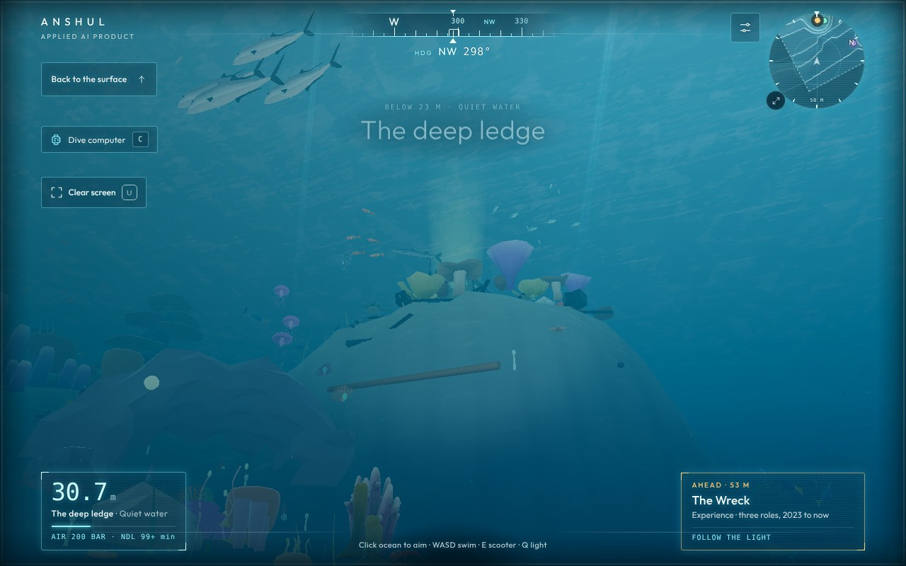

# Water colour: from teal toward a deeper ocean blue

Owner's ask: "Can we also change the tint of the water slightly to be deeper blue? It's kinda teal at the moment, but it can vary."

Same five fixed camera spots before and after, day preset with the clock locked, clear weather, water clarity at the default 125%.
Captured with `node tools/water-shots.mjs http://127.0.0.1:4190/ release/water/<before|after>` against `python serve.py --port 4190`
(Chromium headless, SwiftShader). Fish and other moving life are not frame-locked between runs, so they sit in different places.

| Spot | Before | After |
| --- | --- | --- |
| Surface from above |  |  |
| Sand shallows by the anchor |  |  |
| Reef slope toward the drop-off |  |  |
| The wreck |  |  |
| Deep shelf beside the spire |  |  |

Average screen colour (RGB, 0-255), before → after:

| Spot | Before | After |
| --- | --- | --- |
| Surface from above | 148, 181, 190 | 146, 177, 191 |
| Sand shallows | 98, 167, 171 | 101, 161, 175 |
| Reef slope | 53, 124, 135 | 48, 113, 136 |
| Wreck | 55, 114, 124 | 49, 105, 124 |
| Deep shelf | 37, 116, 126 | 26, 103, 128 |

Blue holds; green and red drop, more so with depth. The shallows lose the least.
